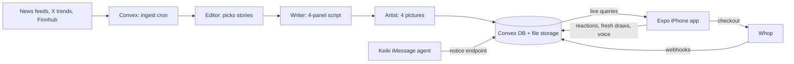

# Doodle Daily

The news, drawn in crayon. Every morning Doodle Daily turns real stories in tech,
money, culture and memes into 4-panel comics starring a cast of five characters.
Each comic ends with the real story in two plain sentences and a link to the source.
Read one whole comic and the day is cleared; come back tomorrow and it becomes a
combo, like Duolingo for the news.

You can also:

- **Draw a fresh one**: Robo, the mascot, draws a new comic from the latest stories
  while you watch, panel by panel.
- **Commission a comic** about anything (a topic or an article link) for $1.
- **Listen**: tap the speaker in the Reader and Newsie reads the captions and the
  real story aloud.
- **Get Plus** ($3 a month): every back issue, unlimited fresh draws, a weekly
  combo freeze, and a free day of Plus for every 7-day combo.
- **Start your own paper**: pick a niche and a price, and Doodle Daily creates a
  real Whop product with a monthly plan, draws a sample comic and gives you a
  checkout link to share.

Built in one day (Sunday, November 15, 2026) at the Consumer Mobile Hackathon.
Expo (React Native, Expo Router, TypeScript) on iPhone, no sign-in: a random
device id identifies the reader.

## Architecture



| Piece | How it is used |
| --- | --- |
| **Capy** | Wrote the whole app. Each build step is a thread with its own prompt in `prompts/` (scaffold, backend pipeline, app screens, combo and Robo, Whop, polish and tests, voice, Keiki), run in parallel on separate machines and shipped as the pull requests listed below. |
| **Convex** | The entire backend (`convex/`): schema, live queries the app subscribes to, crons for the morning edition, the scripted pipeline (ingest, editor, writer, artist) with retries, locks, deadlines and a daily spend cap, file storage for the pictures and voice clips, and the HTTP routes for Whop webhooks. |
| **OpenAI** | Draws every panel with the image edits API, using the five cast sheets as references so the characters stay on model, and voices the narration with `gpt-4o-mini-tts`. The editor and writer run on Anthropic's API. |
| **Whop** | Payments, in the Whop sandbox: the $1 commission checkout, the Plus membership, combo milestones that extend Plus by a day through the memberships API, refunds when a commission fails, and one Whop product plus monthly plan per "Start your own paper". Webhooks are verified (Standard Webhooks) and deduplicated in Convex. |
| **Revyl** | Builds the iOS app in the cloud as a standalone simulator build and runs it on a cloud iPhone. The plain-English Revyl tests in `.revyl/tests/` cover reading and clearing the day, reactions, Draw a fresh one, a paid commission, back issues and the paywall, voice, and the Papers shelf; `.revyl/config.yaml` turns on proof of changes for pull requests. |
| **Keiki** | Text Newsie on iMessage: send a link or a few words to the Doodle Daily agent and it texts back a finished comic with the real story, the source and a link into the app. |

Where the build differs from the docs is written down in `NOTES.md`. The design
system (neon arcade shell, crayon paper comics) is in `docs/DESIGN.md`, the product
brief in `docs/BRIEF.md`, and the pitfalls we designed against in `docs/LESSONS.md`.

## How to run

Requirements: Node 22+ and npm.

```bash
npm install
npm run check            # typecheck + eslint + vitest (no network, no keys)
```

**App against the live backend.** The app talks to the Convex deployment
`https://resilient-ostrich-674.convex.cloud` by default.

```bash
npx expo start           # then open it in a development build or the simulator
```

Launch flags for demos and tests (build-time env or a deep link):
`doodledaily://launch?skipIntro=1&reset=1` skips the intro and clears local state;
`fixtures=1` runs the app on bundled sample data with no network.

**Backend.** With `CONVEX_DEPLOY_KEY` set, `npx convex dev --once` pushes functions.
`npx convex run seed:run '{}'` writes a sample issue using mock providers (free);
`npx convex run pipeline:buildEdition '{}'` builds today's issue with the real
providers when their keys are set. See the admin table in `NOTES.md`.

**iOS simulator build (what Revyl runs).** A standalone Release build with the
JavaScript bundled in. "Draw a fresh one" needs the demo secret at build time; see
`NOTES.md` (Thread 3) for how to pass it without committing it.

```bash
npm ci
CI=1 npx expo prebuild --platform ios --clean
EXPO_PUBLIC_CONVEX_URL=https://resilient-ostrich-674.convex.cloud xcodebuild \
  -workspace ios/DoodleDaily.xcworkspace -scheme DoodleDaily -configuration Release \
  -sdk iphonesimulator -destination 'generic/platform=iOS Simulator' \
  -derivedDataPath ios/build CODE_SIGNING_ALLOWED=NO build
# -> ios/build/Build/Products/Release-iphonesimulator/DoodleDaily.app
```

**Revyl tests.** With the Revyl CLI and the app registered as `doodle-daily`:

```bash
revyl test create read-and-clear-the-day --from-file .revyl/tests/01-read-and-clear-the-day.yaml
revyl test run read-and-clear-the-day
```

## Pull requests

| # | What |
| --- | --- |
| [#1](https://github.com/yiranhu361/doodle-daily/pull/1) | Scaffold: Expo app, Convex backend, mock providers, seed and Today screen |
| [#3](https://github.com/yiranhu361/doodle-daily/pull/3) | Whop sandbox spike findings |
| [#4](https://github.com/yiranhu361/doodle-daily/pull/4) | Daily combo, celebration, Robo poses and intro |
| [#5](https://github.com/yiranhu361/doodle-daily/pull/5) | Backend pipeline: real providers, ingest, editor, writer, artist, fresh draws |
| [#6](https://github.com/yiranhu361/doodle-daily/pull/6) | App screens: Today, Reader, reactions, share, back issues and test hooks |
| [#7](https://github.com/yiranhu361/doodle-daily/pull/7) | Keiki spike findings |
| [#8](https://github.com/yiranhu361/doodle-daily/pull/8) | Voice: Newsie reads comics aloud (OpenAI speech) |
| [#9](https://github.com/yiranhu361/doodle-daily/pull/9) | Phone checks on main and the demo-secret build recipe |
| [#10](https://github.com/yiranhu361/doodle-daily/pull/10) | Whop payments: commissions, Plus, combo pays for Plus, Start your own paper |
| [#12](https://github.com/yiranhu361/doodle-daily/pull/12) | Revyl tests and this README |

The Keiki iMessage thread (Text Newsie) is still running and adds its own pull
request.

## Layout

| Path | What |
| --- | --- |
| `app/` | Expo Router screens: Today, Reader, back issues |
| `src/` | components, theme, live-data hooks, combo and celebration, Robo, intro, billing sheets, voice |
| `convex/` | schema, public API (pinned by `convex/publicApi.test.ts`), pipeline, providers, Whop billing and webhooks, voice |
| `.revyl/` | Revyl build config and plain-English tests |
| `docs/`, `prompts/`, `NOTES.md` | brief, design, lessons, the build prompts, and where the build differs |
